# EVE Multi-Agent Delegation Demo

An independent portfolio MVP that delegates Earth Observation retrieval across processes:
**LangGraph → official A2A SDK → official EVE MCP servers → real external data → cited artifacts.**
It is not an official ESA product or a Pi School-approved release.

**Recorded evidence (10 October 2026):** a live flood/resource query completed in **16.22s**;
27 automated tests passed; 21/21 offline case expectations passed; live evaluation returned
data for 2/3 cases and honestly reported no matching catalogue data for the third.
[Raw live run](evidence/last-live.json) · [Evaluation](docs/evaluation.md) · [Inspector check](evidence/inspector-validation.json)

```powershell
pwsh -File scripts/setup.ps1
.\.venv\Scripts\python.exe demo.py --mode live  # no key required; explicitly labelled rules planner
.\.venv\Scripts\python.exe demo.py --mode mock  # synthetic data, real A2A/MCP transports
```



## What the live demo proves

The supervisor plans and routes a natural-language EO request, sends a validated delegation
through A2A JSON-RPC to a separate Python service, retrieves its Task with `tasks/get`, and
assembles a structured `DataPart` artifact. The retrieval service launches unmodified official
EVE GDACS and EO Dashboard MCP servers over stdio and uses actual MCP discovery and tool calls.
There are no disguised direct HTTP calls in the application retrieval client.

The captured run retrieved **Flood in India**, with a reported end date of **2026-10-03**, and
an EO Dashboard `alos2_floods` collection URL. Results separate **retrieved disaster evidence**,
**candidate EO resources**, and **general monitoring guidance**. A collection is never described
as verified imagery for the event. Requests containing “recent” filter reported event end dates
to the last 30 days; timezone-free GDACS timestamps are assumed UTC and the assumption is stated.

The default **rules** planner is a limited keyword router. Per the selected no-key scope, no
real LLM execution or model-quality metric is claimed. A real OpenAI-compatible planner is
implemented and can choose tools/filters from a validated schema; configure it as described
below. No new ReAct loop, MCP protocol or A2A protocol is implemented here.

## Installation and one-command demo

Validated on **Windows, Python 3.12**. Project sources target Python 3.11+. Internet access is
needed once to install dependencies and for live external APIs; mock runs need no API keys or
network after setup. Use the virtual environment's Python explicitly to avoid system packages.

PowerShell 7 (or Windows PowerShell with `-File`):

```powershell
cd E:\eve-agent-delegation-mvp   # or your cloned repository directory
pwsh -File scripts/setup.ps1
.\.venv\Scripts\python.exe demo.py
.\.venv\Scripts\python.exe demo.py --mode mock --fault transient
.\.venv\Scripts\python.exe demo.py --mode live --interactive
```

Linux/macOS commands are provided, but have not been validated on those platforms:

```sh
sh scripts/setup.sh
.venv/bin/python demo.py --mode mock
.venv/bin/python demo.py --mode live
```

`requirements.lock` pins the full tested dependency set, including build and check tools;
the only platform-gated entry is pywin32. Setup installs the local project with `--no-deps`
and `--no-build-isolation` after the lock. The official server snapshots and their Apache-2.0
license are included, so the project has no dependency on the developer's research checkouts.
`upstreams.json` includes revisions, inspected source paths and SHA-256 hashes.

The launcher starts two loopback-only services, waits for readiness, executes the query, saves
raw results and trace, then cleans up its owned processes. `--api-port` and `--agent-port`
avoid occupied ports. `--output` chooses an evidence file. Ctrl+C stops a `--serve` session.

## Swagger, REST and independent A2A clients

```powershell
.\.venv\Scripts\python.exe demo.py --mode live --serve
```

- Swagger: `http://127.0.0.1:9100/docs`
- Agent Card: `http://127.0.0.1:9101/.well-known/agent-card.json`
- A2A JSON-RPC endpoint: `http://127.0.0.1:9101/`
- `GET /health`, `POST /api/query`, `GET /api/tasks/{task_id}`,
  `GET /api/tasks/{task_id}/trace`, `GET /api/graph`.

`POST /api/query` returns HTTP 202 and unique `task_id`/`thread_id`. Poll until status is
`success`, `partial`, `no_data`, `rejected` or `failed`:

```json
{"query":"Find a recent flood and Earth Observation resources","mode":"live","planner":"rules"}
```

An independent A2A client can discover the card and submit the JSON payload shown in its skill
example. The skill expects a serialized `Delegation` with `request_id`, `request` and `plan`;
natural-language users go through the Supervisor API. Inspect the official SDK client in
`src/eve_demo/a2a_client.py` for `ClientFactory`, `send_message` and `get_task` usage.
The service uses the official SDK's task lifecycle and a SQLite `TaskStore` adapter.

The captured [Agent Card](evidence/agent-card.json), [MCP tool schemas](evidence/mcp-tools.json),
and [LangGraph SVG](docs/langgraph.svg) were exported from running services/compiled code.
Regenerate with `python scripts/capture_static.py`. That script expects the local SQLite
store for the recorded task; if no live packet exists it records a clearly synthetic mock task.
To re-export the SVGs, run `pwsh -File scripts/render_diagrams.ps1` with Node/npm installed;
adjust the Chromium executable path in `docs/puppeteer.example.json` for your machine.

For official Inspector **structural** validation, clone the revision in `upstreams.json`, then:

```powershell
.\.venv\Scripts\python.exe scripts/verify_inspector.py --inspector PATH_TO_A2A_INSPECTOR
```

This invokes the original `backend/validators.py` against actual captured card/task JSON.
It does not claim an Inspector GUI session or full protocol conformance certification.

## Optional real model planning

Copy `.env.example` to `.env` and configure `OPENAI_API_KEY`, `OPENAI_BASE_URL` and `OPENAI_MODEL`
for an OpenAI-compatible chat-completions provider supporting JSON instructions.

```powershell
.\.venv\Scripts\python.exe demo.py --mode live --planner llm
```

The LLM selects the plan, not the factual retrieval results. Its JSON output is validated
against allowlisted server/tool names and argument schemas, with at most four calls. Invalid
output or missing credentials fails explicitly; no silent fallback to rules/mock occurs.
This path is implemented but **unverified against a real provider**, because no model
credentials were supplied. Real provider planning needs its own evaluation before proposal
claims are expanded. No provider-specific model name is hardcoded.

## Persistence, trace and limits

SQLite stores task records, A2A tasks/receipts, graph checkpoints and ordered trace events.
On Supervisor startup, queued/running jobs resume from the last checkpoint. Completed remote
retrieval receipts are reused for the same request UUID, reducing duplicate external queries
after interrupted delegation. The persisted absolute deadline is retained across restarts.
This is a single-worker local MVP; multi-worker coordination and crash-durable in-flight A2A
execution are outside scope. Restarting the retrieval service keeps completed tasks, but an
in-flight remote task may require a new delegation. It is not a transactional exactly-once system.

Limits: four planned tool calls; at most two attempts per recoverable MCP call; one A2A retry;
14 graph steps; 45-second tool timeout and 120-second total deadline by default. Malformed
payloads are not retried. GDACS may put failures inside successful MCP text payloads, so the
application detects those explicitly. External empty results remain `no_data`; an upstream
failure never triggers synthetic substitution. Mock fault injection is rejected in live mode.

Trace contains UUID, node, timestamp, PID, delegation, tool names/arguments, status, duration,
errors/recovery and returned source links. Credential-like fields/strings are redacted.
Model keys are loaded from environment only. The application emits JSON trace logs; original
upstream logs remain in the ignored runtime directory. The tested newer pydantic-settings emits
an upstream FastMCP `lifespan` annotation warning; tool calls and discovery succeeded despite it.

## Checks and evaluation

```powershell
.\.venv\Scripts\python.exe -m pytest -q --junitxml=evidence/pytest.xml
.\.venv\Scripts\ruff.exe check .
.\.venv\Scripts\ruff.exe format --check .
.\.venv\Scripts\mypy.exe src/eve_demo
.\.venv\Scripts\python.exe -m pip check
.\.venv\Scripts\python.exe scripts/evaluate.py --mode mock
.\.venv\Scripts\python.exe scripts/evaluate.py --mode live
```

The 21 fixture cases run the entire process/protocol chain, including six error/boundary
cases. The live evaluation uses three explicitly selected cases with real official MCP data.
The reports measure case expectations, raw task success, tool selection, A2A round trips,
transient recovery and end-to-end latency/P95. These are **rules-planner** measurements.
See [measured results and limitations](docs/evaluation.md); no mock statistic is presented
as real external-data reliability. Tests also interrupt the supervisor and verify checkpoint
recovery, independent A2A invalid-input behavior, API validation and secret redaction.

## Deliverables and provenance

[Architecture Mermaid](docs/architecture.mmd) · [Actual LangGraph Mermaid](docs/langgraph.mmd) ·
[Source research](docs/research.md) · [60–90s demo narration](docs/demo-script.md) ·
[150–200 word proposal summary](docs/upwork-summary.md) · [Acceptance evidence](docs/acceptance.md) ·
[Upstream notices](THIRD-PARTY-NOTICES.md).

License: Apache-2.0 for this project; upstream licenses and attribution are retained.
No upstream EVE or TheOne repository was edited. This local repository is prepared for
publication; no GitHub upload/publication is claimed by these local run records.
